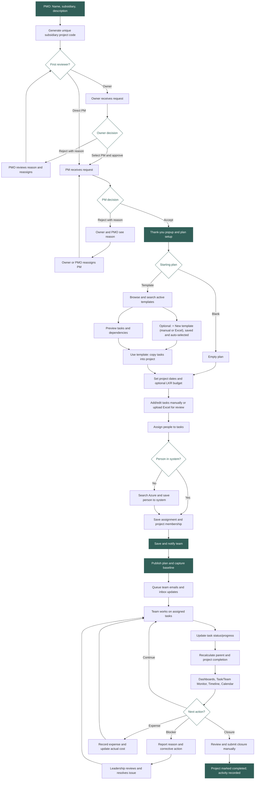
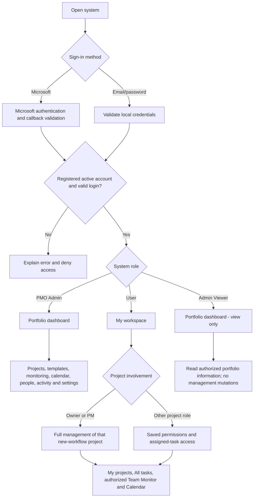
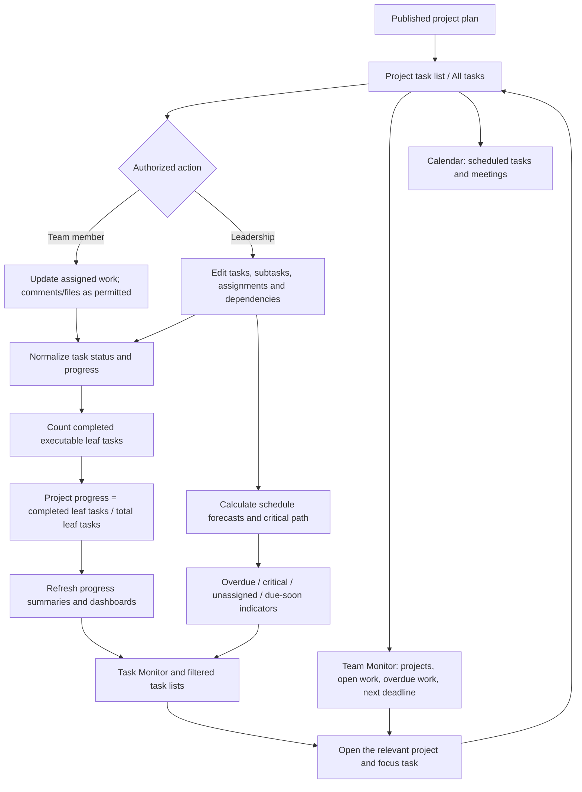
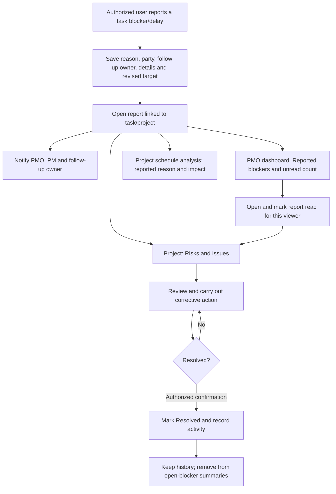
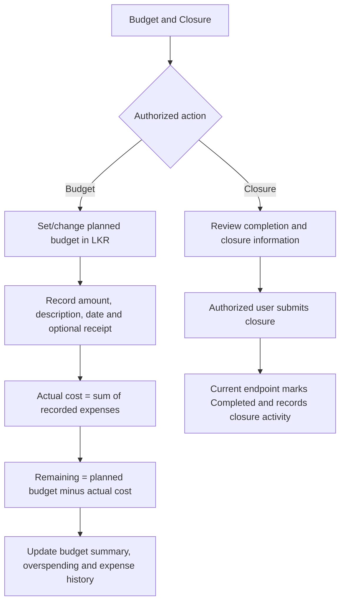
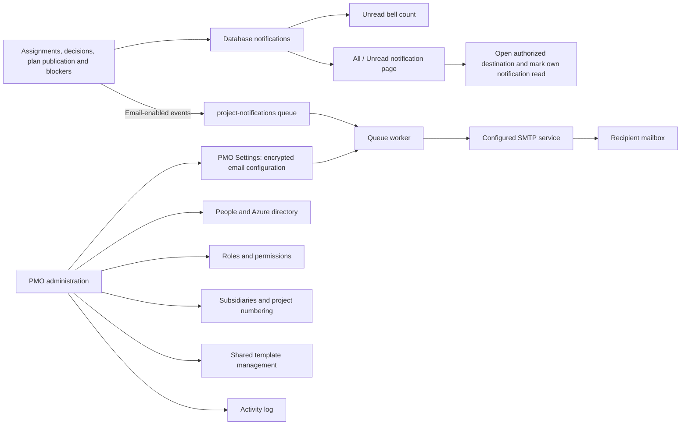

# GS ProjectFlow - Complete system flow

Updated: 11 November 2026. These diagrams reflect the current implementation, including the latest Owner/PM approval changes.

PMO Admin, User and Admin Viewer are system roles. Owner, PM and Team Member are project responsibilities.

## 1. Complete new-project lifecycle

## 2. Sign-in and role-based access

## 3. Daily tasks, progress and monitoring

## 4. Risks, blockers and unread reports

## 5. Budget and closure

## 6. Notifications, email and administration

## Important workflow rules

- Reassignment appears only after rejection. Pending requests cannot be reassigned through UI or direct endpoints.
- After Owner rejection, PMO can reassign. After PM rejection, Owner or PMO can reassign the PM. Only PMO replaces an Owner.
- PM acceptance opens plan setup. Team-ready emails are queued after Save and notify team publishes the plan.
- Ordinary team members cannot open unpublished plans.
- Browse templates is inside plan setup. Entered dates are retained. Shared templates are not modified; project task copies can be edited.
- New-workflow Owner and PM have project-level management access, not company administration. Project deletion remains PMO-only.
- Existing projects retain their legacy workflow and saved role policies.
- Progress counts executable leaf tasks, avoiding parent/subtask double counting. Task completion does not automatically close the project.
- Reading a blocker is separate from resolving it. Critical path does not establish a real-world cause for delay.
- Schedule forecasts are estimates and do not replace the approved baseline.
- Current closure behavior: submitting closure marks the project Completed. There is no separate PMO closure-approval stage or enforced all-tasks-complete gate in that endpoint.
- Database inbox delivery is immediate; email delivery requires the queue worker and working SMTP configuration.
- Admin Viewer has portfolio read-only access; management settings and write operations remain protected.
- The final active PMO account is protected against deletion/demotion.

## Using the diagrams

Open this file in a Mermaid-capable Markdown preview or on GitHub. SYSTEM_FLOW.mmd contains the main lifecycle source for Mermaid editors or export. This documentation does not change application behavior.

